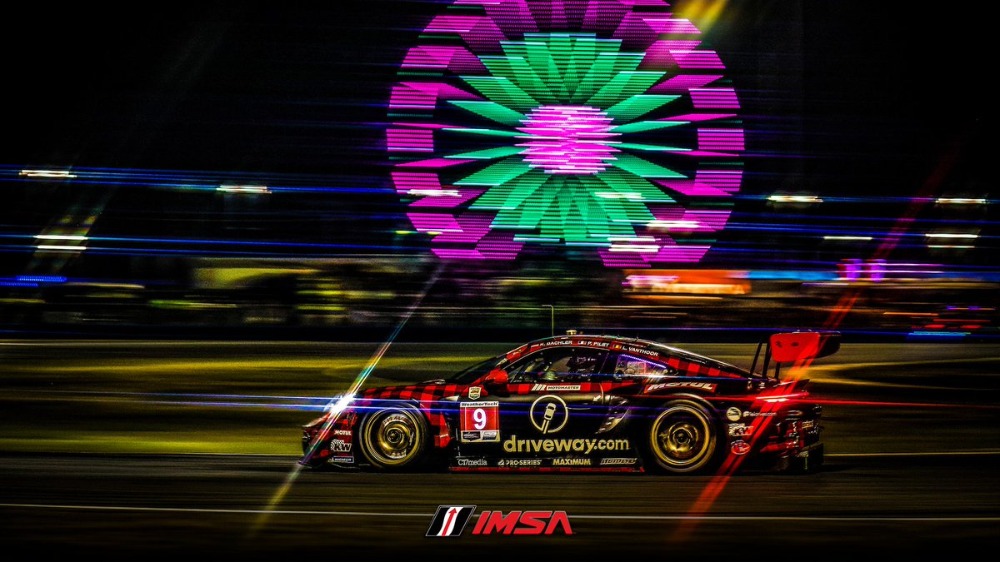

<div align="center">

# 🏁 IMSA Strategy Dashboard

### *Endurance racing data, reimagined as a clean and visual web experience.*

<p>
  
  
  
  
  
</p>

<p align="center">

</p>

</div>

---

## Overview

**IMSA Strategy Dashboard** is a front-end project built to transform official IMSA timing and race data into a cleaner, more visual and more intuitive experience.

Instead of presenting the data as raw tables or isolated CSV files, the application organizes each event into a structured race dashboard focused on **clarity**, **context**, and **readability**.

The goal is to make endurance racing data feel easier to explore, while still preserving the identity and rhythm of each race weekend.

---

## Why this project exists

IMSA data is incredibly rich, but in its raw form it can feel difficult to navigate casually.

This project was created around a simple idea:

> **What if official IMSA race data felt like a polished race analysis interface instead of a collection of files?**

The application focuses on turning public race data into something that feels:
- visual
- readable
- event-driven
- easier to explore
- closer to a motorsport analysis tool than a spreadsheet viewer

---

## Main Experience

The project is built around two main views:

### Season Browser
A season-based race hub where events can be explored through a clean card-based layout.

### Race Dashboard
A dedicated event page that brings together the full identity of a race, including:
- event branding
- circuit presentation
- race context
- structured per-car summaries
- performance charts
- strategy-oriented race reading

---

## What the application includes

- Multi-season race browsing
- Event-based IMSA dashboards
- Circuit information and visual identity
- Per-car race summary cards
- Interactive lap-time charts
- Race context panels
- Strategy-focused views for each car
- Clean navigation between overview and detailed analysis

---

## Strategy and race reading

One of the core ideas behind the dashboard is to go beyond simple lap-time viewing.

The project now includes a more strategy-oriented reading of each race through:
- stop-based summaries
- stint structure
- pit timing context
- strategy timelines
- visual indication of race interruptions and stop windows

This helps each event feel less like a static data page and more like a readable race story.

---

## Design Direction

The visual identity of the project is intentionally built around a few core ideas:

- **Dark motorsport-inspired UI**
- **Compact information blocks**
- **Clear hierarchy between overview and detail**
- **Event-specific visuals through logos and layouts**
- **Subtle accent colors for categories and interactive elements**
- **A cleaner and more premium feeling than raw race data usually offers**

The intention is not to mimic a generic dashboard template, but to create something that feels specifically designed for endurance racing analysis.

---

## Core Stack

The project is intentionally lightweight and fully front-end based.

It is built with:
- **HTML5**
- **CSS3**
- **Vanilla JavaScript**
- **Papa Parse**
- **Chart.js**

No framework is required and no backend is needed.

---

## Data

Race data used in this dashboard is sourced from the public [tobi/imsa_data](https://github.com/tobi/imsa_data) repository.

Huge thanks to Tobias Lütke for making IMSA race data more accessible for analysis and visualization.

---

## Project Structure

```text
tracker/
├── index.html
├── dashboard.html
├── README.md
│
├── css/
│   ├── index.css
│   └── styles.css
│
├── js/
│   ├── index.js
│   └── dashboard.js
│
├── img/
│   ├── hero-bg.jpg
│   ├── layouts/
│   └── logo/
│
└── data/
```

## License

This project is licensed under the MIT License. See the [LICENSE](./LICENSE) file for details.
